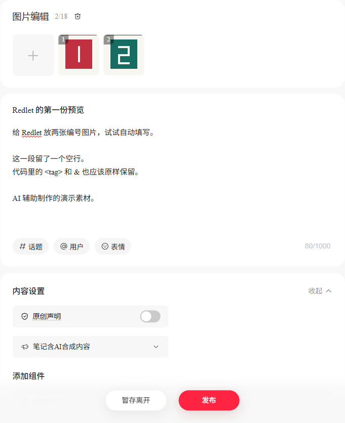

# Redlet

本地运行的小红书图文发布工具。把文案、图片和设置放进一份素材包，Redlet 打开浏览器，填好编辑器并核对预览。

提供素材检查、独立浏览器登录、预览、实际提交和单篇结果核对。



## 开始使用

需要 Node.js 20 或更新版本。Windows 默认使用已安装的 Chrome；其他系统使用 Playwright Chromium（安装后运行 `npx playwright install chromium`）。

```sh
npm ci
npm run build
node dist/cli.js check examples/demo/post.json
node dist/cli.js login --site rednote
node dist/cli.js preview examples/demo/post.json
```

第一次在 Redlet 打开的专用窗口里手动登录。程序识别创作平台显示名后，会保留这份独立会话。之后的预览会核对该显示名；也可用 `--account "昵称"` 指定预期账号。

预览完成后，浏览器保持打开供你查看。关闭窗口结束命令，或加 `--close` 在保存结果后自动关闭。预览会上传指定图片，平台可能自动存草稿。

## 发布和核对

预览确认后，用素材包内的内容 ID 明确指定本次提交：

```sh
node dist/cli.js publish my-note/post.json --confirm my-note-001
node dist/cli.js verify my-note-001 --site rednote
```

`publish` 会先按标题排查既有笔记，再准备并回读预览，保存截图及提交前记录，然后点击一次发布。只有在本篇卡片出现在相应状态页签后，才记录 `published`、`submitted_for_review` 或 `rejected`。成功提示只表示提交得到确认。

结果暂时查不到时记为 `verification_pending`，用 `verify` 继续查本篇。相同 ID 在已经尝试提交后不能再次发布；更改文案或账号也不能复用旧 ID。任务互斥和状态保存在本地 `.runtime/tasks/`；核对先取得锁，再读取最新记录，保留原提交时间。进程崩溃留下锁时，确认该命令已经结束再移走对应 `.lock`，之后先运行 `verify`。

核对先使用创作平台的“搜索已发布的笔记”，再查相应状态。已发布结果结合搜索回读和卡片所属视图校验；审核／未通过页签会清空该搜索框，因此只用精确标题定位当前加载的目标卡片，不导出或读取其他卡片正文。程序等待页面正常列表请求完成及加载结束，不主动请求列表接口，也不读取列表响应正文。重名、状态请求乱序或无法建立新结果时，保留待核对；没有取得实际公开链接时不补造链接。

## 一份素材包

```json
{
  "schema_version": 1,
  "content_id": "my-note-001",
  "title": "今天改了一个小地方",
  "body_file": "body.txt",
  "images": ["images/01.png", "images/02.png"],
  "site": "rednote",
  "ai_generated": true,
  "visibility": "private"
}
```

正文是 UTF-8 纯文本，也可以用 `body` 直接写进 JSON，二者选一。文件路径相对素材包，不允许走出该目录。标题上限 20 个 Unicode 字符，正文上限 1000 个；支持 1–18 张 PNG、JPEG、WebP，单张最大 32 MiB。

`site` 可选 `rednote`、`xiaohongshu`。`visibility` 可选 `private`（仅自己可见）、`public`（公开可见）。`ai_generated` 对应“笔记含AI合成内容”。两个入口的实际验收状态见 [验证记录](docs/VERIFICATION.md)。

## 预览怎么核对

程序逐张上传图片，核对上传完成响应，并将本地缩略图的字节摘要与素材逐张比较，再填写标题、正文和设置。随后回读标题、空行（含末尾空段）、图片数量与顺序、AI 声明及可见范围。平台若转换了缩略图字节或换成无法读取的远程图，当前版本会停止并报告无法核对。账号不符、已有内容或无法核实时会停止，并报告失败。

每次结果和编辑区截图保存在 `.runtime/receipts/`。截图遮盖匹配的账号显示名和头像。浏览器配置、账号绑定与回执均保留在本地，`.runtime/` 已被 Git 忽略。用 `--state-dir DIR` 可另选运行目录。

## 开发

```sh
npm test
npm run check
npm run build
```

浏览器测试使用本机 Chrome（Windows）或 Playwright Chromium，只访问拦截的受控页面。实际创作平台试验单独记录。

- [首版设计](docs/DESIGN.md)
- [上游复用调研](docs/REUSE_RESEARCH.md)
- [制作记录](docs/BUILD_LOG.md)
- [验证记录](docs/VERIFICATION.md)

参考 [xiaohongshu-mcp](https://github.com/xpzouying/xiaohongshu-mcp) 的页面步骤与定位线索，首版使用 TypeScript 和 Playwright 独立实现。项目采用 [Apache-2.0](LICENSE) 许可证。
