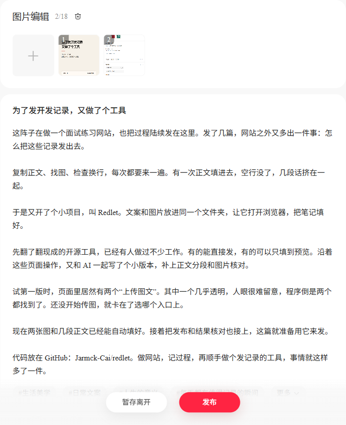

# Redlet

本地运行的小红书图文发布工具。把文案、图片和设置放进一份素材包，Redlet 打开浏览器，填好编辑器并核对预览。

提供素材检查、独立浏览器登录、预览、实际提交、单篇结果核对和本地状态查看。



## 开始使用

需要 Node.js 20 或更新版本。Windows 默认使用已安装的 Chrome；其他系统使用 Playwright Chromium（安装后运行 `npx playwright install chromium`）。

```sh
npm ci
npm run build
node dist/cli.js check examples/demo/post.json
node dist/cli.js login --site rednote
node dist/cli.js preview examples/demo/post.json
```

第一次在 Redlet 打开的专用窗口里手动登录。程序识别创作平台显示名后，会保留这份独立会话。之后的预览会核对该显示名；也可用 `--account "昵称"` 指定预期账号。

预览完成后，浏览器保持打开供你查看。关闭窗口结束命令，或加 `--close` 在保存结果后自动关闭。预览会上传指定图片，平台可能自动存草稿。

## 发布和核对

预览确认后，用素材包内的内容 ID 明确指定本次提交：

```sh
node dist/cli.js publish my-note/post.json --confirm my-note-001
node dist/cli.js verify my-note-001 --site rednote
node dist/cli.js status my-note-001 --site rednote
```

`publish` 先以内容 ID 取得任务锁并核对记录，再准备并回读预览，保存截图及提交前记录，然后点击一次发布。只有在本篇卡片出现在相应状态页签后，才记录 `published`、`submitted_for_review` 或 `rejected`。成功提示只表示提交得到确认。

结果暂时查不到时记为 `verification_pending`，用 `verify` 继续查本篇。相同 ID 在已经尝试提交后不能再次发布；更改文案或账号也不能复用旧 ID。任务互斥和状态保存在本地 `.runtime/tasks/`；核对先取得锁，再读取最新记录，保留原提交时间。进程崩溃留下锁时，确认该命令已经结束再移走对应 `.lock`，之后先运行 `verify`。

`status` 只读本地记录，不启动浏览器，也不更新平台状态；即使任务正在由另一个命令处理，也可查看最后一次完整保存的记录。输出用 `source: "local"` 标明来源，成功读到记录就返回退出码0；记录不存在则返回2。需要最新平台结果时使用 `verify`。

发布／核对输出将本次状态与上次正向确认分开：`status` 是本次结果，`lastCheckedAt` 是最近一次结果处理时间，`lastConfirmed` 保留确实在平台核对到的状态和 `verifiedAt`。例如本次找不到目标会显示 `verification_pending`，并继续保留此前确认的“审核中”或“已发布”。启动或核对出错时也输出这份结果，同时保留错误退出码与原因。原始 `attemptedAt`、`submittedAt` 和笔记ID不因查询失败重置。旧记录可继续使用；如果旧记录只剩待核对和一个时间，没有明确的历史状态，程序不推测补齐。

核对先使用创作平台的“搜索已发布的笔记”，再查相应状态。已发布结果结合搜索回读和卡片所属视图校验；审核／未通过页签会清空该搜索框，因此只用精确标题定位当前加载的目标卡片，不导出或读取其他卡片正文。程序等待页面正常列表请求完成及加载结束，不主动请求列表接口，也不读取列表响应正文。首次尚无笔记ID时，会检查已发布、审核中和未通过三个当前加载视图中的精确标题；只有唯一候选且取得有效ID，才回到目标视图按该ID重新核对。同一视图或不同状态视图出现同名候选、缺少ID、状态请求乱序、当前页面找不到目标或无法建立新结果时，保留待核对；查不到不代表历史中不存在，也不会触发重发。首次标题定位只覆盖当前加载结果，不能证明完整历史中没有同名笔记；不同篇目请使用容易区分的标题。防重复依赖本地内容 ID 记录，不扫描账号历史来推断是否曾经发过。没有取得实际公开链接时不补造链接。

## 公开样例：Hello Redlet

[样例目录与说明](examples/hello-redlet/)包含四段正文、两张原创示例配图和配置文件，可以改成自己的内容。[下载整份 ZIP](docs/assets/hello-redlet.zip)，或直接使用仓库里的文件：

```sh
node dist/cli.js check examples/hello-redlet/post.json
node dist/cli.js preview examples/hello-redlet/post.json
```

先按前面的步骤安装、构建并登录。样例默认仅自己可见，命令停在预览；配图源文件和 Apache-2.0 许可随包提供。2026-10-23 的真实运行结果见[核对记录](docs/VERIFICATION.md#hello-redlet-公开样例2026-10-23)。下载包仅含编辑示例、原创图片及其源文件，不含浏览器数据、账号资料或真实创作页面截图。

## 一份素材包

```json
{
  "schema_version": 1,
  "content_id": "my-note-001",
  "title": "今天改了一个小地方",
  "body_file": "body.txt",
  "images": ["images/01.png", "images/02.png"],
  "tags": ["AI", "独立开发"],
  "site": "rednote",
  "ai_generated": true,
  "visibility": "private"
}
```

正文是 UTF-8 纯文本，也可以用 `body` 直接写进 JSON，二者选一。文件路径相对素材包，不允许走出该目录。标题上限 20 个 Unicode 字符，正文上限 1000 个；支持 1–18 张 PNG、JPEG、WebP，单张最大 32 MiB。

`site` 可选 `rednote`、`xiaohongshu`。`visibility` 可选 `private`（仅自己可见）、`public`（公开可见）。`ai_generated` 对应“笔记含AI合成内容”。两个入口的实际验收状态见 [验证记录](docs/VERIFICATION.md)。

## 话题标签

`tags` 是可选话题名称数组，省略或写空数组沿用原流程。可以带一个前导`#`，工具会去掉首尾空白、按完整名称去重并保留顺序。本版支持最多10个不同话题；名称不能含额外`#`、换行或控制字符。正文加生成的话题文本一起检查现有1000字符工具上限。

Redlet在正文末尾另起一段，逐个输入`#话题`并选择名称完全匹配的候选。平台若显示精确的“新建话题”选项，也需等它生成带真实ID的关联节点后才算成功。相似候选、多个同名候选、查不到或只有普通`#文字`时会停止，并指出哪个话题无法核对。

预览回执记录选中的名称、顺序与平台话题ID；提交前两次回读还会核对这些ID。更改话题会改变素材指纹，已尝试提交的内容ID仍不能再次发布。正文中的普通`#`原样保留；希望关联的平台话题请放入`tags`，避免在正文里重复填写。

可以直接给定话题，也可以让正在协作的AI助手根据**本篇正文**提出候选与简短理由，你选定后再写入`tags`，一起审阅和发布。推荐本身不自动填入稿包，也不触发发布；此流程无需给Redlet配置模型或密钥。

带话题的公开样例仍默认仅自己可见，先检查再预览：

```sh
node dist/cli.js check examples/hello-redlet/post-with-topics.json
node dist/cli.js preview examples/hello-redlet/post-with-topics.json
```

## 预览怎么核对

程序逐张上传图片，核对上传完成响应，并将本地缩略图的字节摘要与素材逐张比较，再填写标题、正文和设置。随后回读标题、空行（含末尾空段）、图片数量与顺序、AI 声明及可见范围。平台若转换了缩略图字节或换成无法读取的远程图，当前版本会停止并报告无法核对。账号不符、已有内容或无法核实时会停止，并报告失败。

每次结果和编辑区截图保存在 `.runtime/receipts/`。截图遮盖匹配的账号显示名和头像。浏览器配置、账号绑定与回执均保留在本地，`.runtime/` 已被 Git 忽略。用 `--state-dir DIR` 可另选运行目录。

## 开发

```sh
npm test
npm run check
npm run build
```

浏览器测试使用本机 Chrome（Windows）或 Playwright Chromium，只访问拦截的受控页面。实际创作平台试验单独记录。

- [首版设计](docs/DESIGN.md)
- [上游复用调研](docs/REUSE_RESEARCH.md)
- [制作记录](docs/BUILD_LOG.md)
- [验证记录](docs/VERIFICATION.md)

参考 [xiaohongshu-mcp](https://github.com/xpzouying/xiaohongshu-mcp) 的页面步骤与定位线索，首版使用 TypeScript 和 Playwright 独立实现。项目采用 [Apache-2.0](LICENSE) 许可证。
